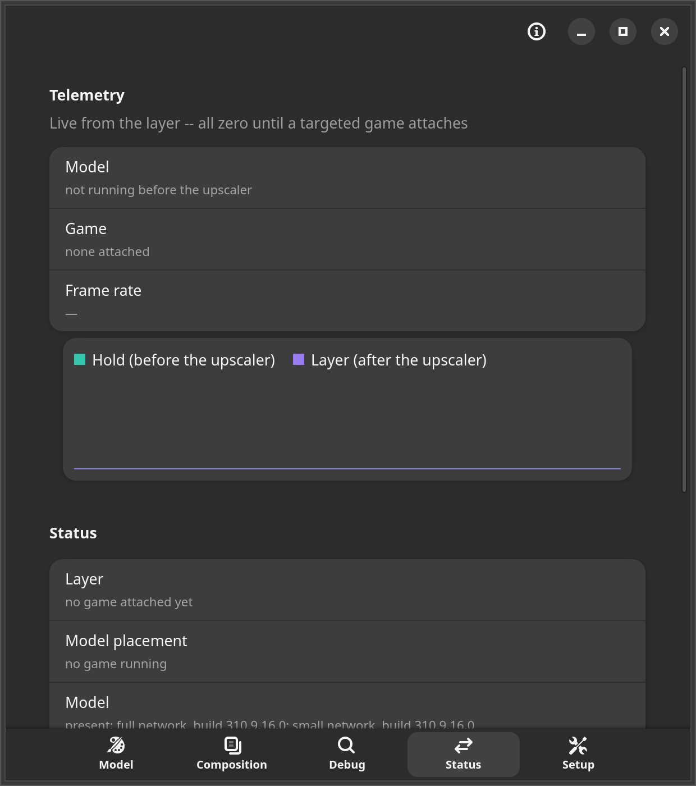
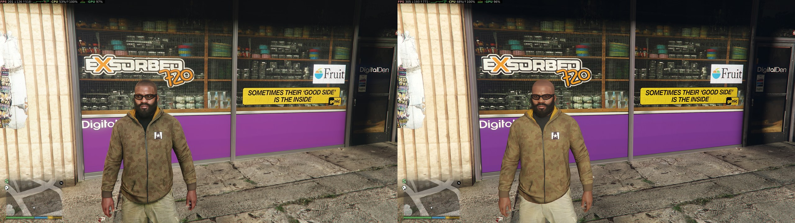
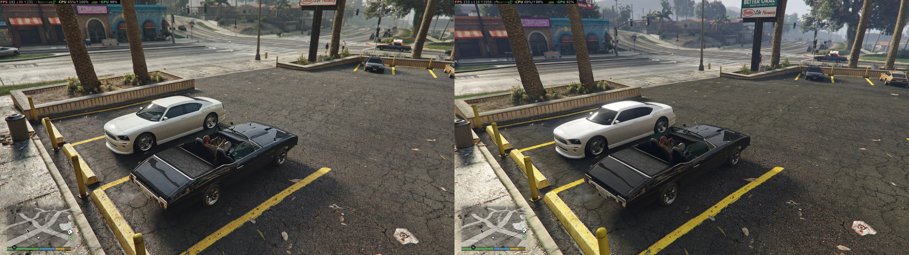
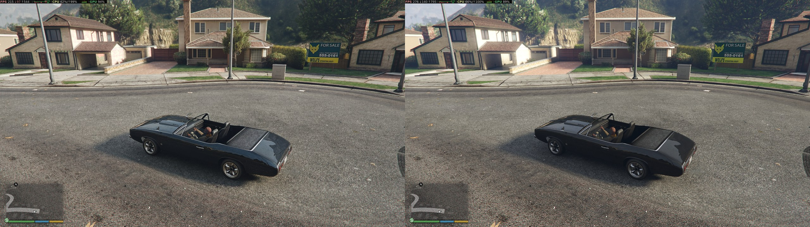
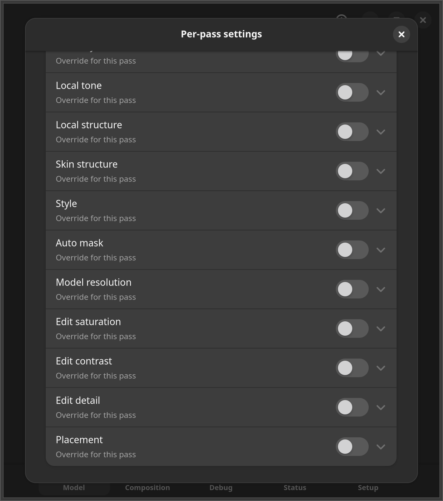

# Neural Forge

Neural Forge runs NVIDIA's DLSS 5 Neural Rendering model (the network in `nvngx_dlssnr.dll`, NGX
"Feature 18") in Linux and Proton games. A Vulkan implicit layer inside the game runs the network
itself, on the game's GPU, with [OpenDLSS-NR](https://github.com/maanHimself/OpenDLSS-NR)'s
implementation of it, and writes the model's answer back into the game's picture. There is no
Windows helper, no Wine prefix and no runner: NVIDIA's DLL is needed once, to extract the model's
weights from it. It is written in Rust, with a GTK4/libadwaita settings app and a CLI. It started
as a from-scratch rebuild of [DLSS5VKLayer](https://github.com/bmitch87/DLSS5VKLayer)'s
architecture and now adapts some of its source (AGPL-3.0); [ATTRIBUTION.md](ATTRIBUTION.md) says
exactly what was taken and from where.

This is experimental, personal-use software. It runs NVIDIA's proprietary model weights outside
NVIDIA's own runtime. Read [Legal](#legal) before you use it.

Repository: [labj1987/neural-forge](https://github.com/labj1987/neural-forge).

| Model settings | Setup | Status |
|---|---|---|
|  |  |  |

The screenshots show default settings with no game running.

### In games

The same moment with the effect on (left) and off (right), toggled in game: GTA V Enhanced, RTX 5070
at 2560x1440, DLSS Balanced, DLSS Frame Generation 4x, ray tracing on, the full network before the
upscaler. The fps counter in the top-left corner is MangoHud, counting frame-generated frames. Each
pair was taken a few seconds apart, so the camera and traffic moved a little.

A shop front: 201 fps shown with the effect, 305 without.



A parking lot: 192 fps shown with the effect, 233 without.



A residential street: 215 fps shown with the effect, 276 without.



## How it works

The network runs inside the game's process, in the Vulkan layer, on the game's GPU. NVIDIA's DLL is
not loaded at run time: the layer reads the model's weights from the folder `extract-model` wrote
(see [Install](#install)). Two networks come in NVIDIA's DLL; both are extracted, and the Setup
tab's **Network** row chooses which one runs:

- **Full network** (71 blocks), in every build of the DLL, and the default. Its shading and depth are
  stronger.
- **Small network** (31 blocks, the same kinds of blocks with fewer of each), in build 310.9.16. It
  takes about half the GPU time of the full one and changes the picture less. It is what NVIDIA's own
  runtime runs from build 310.9.16 at its default preset.

A game that is running switches to the chosen network at once: its next frames go to DLSS untouched
while the network loads, and the network's history starts afresh. When the chosen network is not
extracted (a DLL without the small one), the other one runs.

Each network's answer for an input frame is bit-exact with NGX's own
([docs/NATIVE_BACKEND.md](docs/NATIVE_BACKEND.md), 0.6 and "The small network").

The model runs in one of three places. With the Model tab's **Placement** at **Auto** (the default) the
layer picks the place for each game by itself:

- **Before the upscaler**, when the game uses DLSS Super Resolution (at Quality, Balanced,
  Performance or DLAA). The layer recognises the frame the game hands to
  DLSS: the scene at render resolution, in HDR (16-bit float), without the HUD. It holds that DLSS
  submission, runs the network on the frame (every frame while the camera is still, every second
  frame in motion, with the edit cache carrying it between), with DLSS's motion vectors and camera
  jitter for its history, and writes the answer back before DLSS upscales it. DLSS then upscales the
  enhanced frame. The model works on fewer pixels and gets the input it was made for. Games that
  record their frame in DLSS's own command buffer (Crimson Desert) are held inside that buffer.
- **After DLSS**, when the game runs DLSS Ray Reconstruction: Ray Reconstruction's input is the noisy
  ray-traced frame before its denoising, which is not a frame the model can improve, so the model runs
  right after DLSS instead, on its denoised, upscaled frame at the output resolution, before the game's
  post-processing and HUD, with DLSS's motion vectors for its history. Where DLSS's output cannot be
  held there, the model runs on the finished frame. Switching Ray Reconstruction on or off in a game
  moves the model within a few frames.
- **On the finished frame**, for everything else: native resolution, games without DLSS, and
  devices without NVIDIA's `VK_NVX_image_view_handle`. The finished 8-bit
  frame is captured at present, answered by the network and composited back onto the same frame
  before it is shown. It has no history by default (no motion vectors there). The frame has the
  game's HUD in it: the layer finds the HUD and keeps the model's change off it (see
  [Usage](#usage)).

The game's own **DLSS Frame Generation** works with the model before the upscaler and after DLSS.
Generated frames are built from enhanced frames, and the model runs once per real frame.

To run the model on the finished frame instead, set Placement to Finished frame in the Model tab (live,
no relaunch). `NEURAL_FORGE_PREUPSCALE=off` in the launch options loads no network at all: the game's
frames are presented as it made them, the rollback when something looks wrong.

How it works, step by step: [docs/ARCHITECTURE.md](docs/ARCHITECTURE.md).

## Measured results

### GTA V Enhanced, before the upscaler

GTA V Enhanced's built-in benchmark on the test machine: RTX 5070 (12 GB), 2560x1440, DLSS Balanced,
DLSS Frame Generation 4x, ray tracing on, script mods off, pass 4 (about 117 s), three runs each (the
off row: one run, 2026-10-16). Real fps is the game's own frames; shown fps counts the generated ones
too. Measured 2026-10-19 with the default settings (keep the game's sky on, one pass).

| Model | Real fps | Shown fps | Network GPU time on the frames it runs | Weights in video memory |
|---|---|---|---|---|
| Off (Neural Forge not loaded) | 76.8 | 309.0 | - | - |
| Full network | 65.2 | 262.4 | 6.9 ms | 140 MB |
| Small network | 73.4 | 295.4 | 3.9 ms | 108 MB |

The network runs on every frame while the camera is still and on every second frame while it moves (the
edit cache carries it between), so about half the frames pay its time in this benchmark.

**Model resolution** before the upscaler, in the same game with frame generation off (DLSS's input
1486x836; added detail measured on a fixed patch of a building's facade, against the model off):

| Model resolution | Real fps | Network GPU time | Added detail |
|---|---|---|---|
| Off | 90.3 | - | x1.00 |
| Full | 77.1 | 6.05 ms | x1.28-1.32 |
| Quality | 84.4 | 3.20 ms | x1.01 |
| Performance | 85.2 | 3.04 ms | x0.97-0.98 |
| Ultra Performance | 86.8 | 2.65 ms | x1.10 |

At DLSS's input size the smaller model resolutions keep little of the detail the model adds: before the
upscaler, use Full.

### Crimson Desert, after DLSS (Ray Reconstruction)

Crimson Desert with DLSS Ray Reconstruction and frame generation on, 2560x1440, placement Auto: the model
runs after DLSS on its 2560x1440 output. Shown fps counts the generated frames; network GPU time is per frame
the model runs on. No missed frames and no GPU fault in any run.

| Network, model resolution | Shown fps | Network GPU time |
|---|---|---|
| Model off | 183 | - |
| Full network, Full | 120-122 | 15.8 ms |
| Small network, Full | 140 | 9.2 ms |
| Full network, Quality | 143 | 8.3 ms |
| Full network, Performance | 150-153 | 5.4 ms |
| Full network, Ultra Performance | 161 | 3.8 ms |
| Full network on the finished frame (Placement: Finished frame) | 36 | - |

At the output size, Quality keeps the detail the model adds at Full and Performance most of it; Ultra
Performance is a little softer. With Ray Reconstruction off, the same game runs 176 fps shown with the
model before the upscaler (Auto), 133 with it after DLSS (Placement: After DLSS) and 41 on the finished
frame. With the game's HDR on (Proton-GE, Wayland) the model after DLSS runs as in SDR: the same holds per
second and the same size of change.

Hogwarts Legacy with Ray Reconstruction (switched on in its menu) and frame generation 4x, Full: 137 fps
shown with the model after DLSS (25 on the finished frame), 15.2 ms network GPU time.

### The network on its own

The network's time per frame on its own (`dlss5vk bench`, 1707x960, the DLSS input of GTA V at DLSS
Quality): full 7.03 ms, small 3.81 ms. In the game it also waits for the game's own GPU work. Games
are tested at 2560x1440 only (see [Known issues](#known-issues) for 4K). Details and the record of
every measurement: [docs/HARDWARE_VALIDATION.md](docs/HARDWARE_VALIDATION.md) and
[docs/NATIVE_BACKEND.md](docs/NATIVE_BACKEND.md).

## Tested games

Each game was run on the test machine (RTX 5070, 2560x1440, Proton) with its own settings as found:
DLSS on, the game's frame generation on wherever it has it, no frame-rate cap. In each one the model
ran with no missed frames and no GPU fault.

| Game | Engine, API | DLSS used | Where the model runs |
|---|---|---|---|
| GTA V Enhanced | RAGE, DX12 | Super Resolution, Frame Generation 4x | Before the upscaler |
| Crimson Desert | BlackSpace, DX12 | Ray Reconstruction, dynamic Frame Generation | After DLSS with Ray Reconstruction on; before the upscaler, inside DLSS's buffer, with it off |
| GTA San Andreas - The Definitive Edition | Unreal Engine 4 | Super Resolution | Before the upscaler |
| God of War (2018) | Santa Monica Studio, DX11 | Super Resolution | Before the upscaler |
| Marvel's Spider-Man Remastered | Insomniac, DX12 | Super Resolution, Frame Generation | Before the upscaler |
| Shadow Warrior 3: Definitive Edition | Unreal Engine 4, DX12 | Super Resolution | Before the upscaler |
| Lords of the Fallen (2023) | Unreal Engine 5, DX12 | Super Resolution, Frame Generation (launch option `-DLSSFG`) | Before the upscaler, inside DLSS's buffer |
| Remnant II | Unreal Engine 5, DX12 | Super Resolution, Frame Generation | Before the upscaler, inside DLSS's buffer |
| Hogwarts Legacy | Unreal Engine 4, DX12 | Super Resolution, Ray Reconstruction, Frame Generation | After DLSS with Ray Reconstruction on; before the upscaler, inside DLSS's buffer, with it off |

Setup notes for these games:

- **GTA San Andreas - The Definitive Edition** resets its Frame Rate setting to 60 at every launch,
  whatever its settings files say (a game bug). Set it to Unlocked in Options > Graphics each time.
- **Shadow Warrior 3** greys out its NVIDIA DLSS option while FidelityFX CAS is on (Settings >
  Video): set CAS to Off and DLSS becomes selectable. Its first launch also benchmarks the machine and
  picks the Low preset under Proton; set Overall Quality yourself.
- **Marvel's Spider-Man Remastered** starts with DLAA-like dynamic resolution (target 60 fps), V-Sync
  on and frame generation off: set Upscale Quality to a fixed mode, Frame Generation to DLSS Frame
  Generation and V-Sync off (Settings > Display and Graphics).
- **Crimson Desert** compiles shaders on its first launch after a Neural Forge update; the effect
  starts once it is in the world.
- **Lords of the Fallen (2023)** has no Frame Generation option in its menu: the developers turned
  DLSS Frame Generation off in patch 1.009 (October 2023), and the launch option `-DLSSFG` turns it
  back on (patch 1.1.193): `NEURAL_FORGE_ENABLE=1 %command% -DLSSFG`. While the game's settings file
  says frame generation is on (`DLSSFrameGenerationEnabled=True` in
  `AppData/Local/LOTF2/Saved/Config/Windows/GameUserSettings.ini`), VSync and Reflex are on and
  greyed out; set it to `False` with the game closed to change them, at the cost of frame generation.

## Requirements

- x86_64 Linux with glibc 2.39 or newer (Ubuntu 24.04, Fedora 40 or later), the Vulkan loader, and an NVIDIA RTX 40-series or newer
  GPU (compute capability 8.9 or higher: the network's kernels use FP8 tensor-core instructions that
  RTX 20 and 30-series cards do not have) whose driver offers `VK_NV_cuda_kernel_launch`, `VK_KHR_cooperative_matrix`, `VK_NV_cooperative_matrix2` and
  `VK_EXT_shader_float8` (tested on an RTX 5070 with drivers 615.71.09 and 615.78.08). On non-NVIDIA
  GPUs the layer does nothing (a hybrid laptop's integrated GPU is left alone).
- 64-bit games. There is no 32-bit layer: a 32-bit process has no `VK_NV_cuda_kernel_launch`.
- GTK 4.12 or newer and libadwaita 1.5 or newer, from the system. The AppImage uses the host's
  GTK and libadwaita. Release builds are made on Ubuntu 24.04 (GTK 4.14, libadwaita 1.5).
- NVIDIA's own Neural Rendering DLL (`nvngx_dlssnr.dll`), once, to extract the model's weights
  from: build 310.9.16 for the small network, or any build that carries the full one.
  This project does not and cannot ship the DLL or the weights.
- For the model before the upscaler: a game that uses DLSS through Vulkan (under Proton, a DX12 game
  through vkd3d-proton and DXVK-NVAPI).

## Install

Download the AppImage from [Releases](https://github.com/labj1987/neural-forge/releases):

```bash
chmod +x neural-forge-*-x86_64.AppImage
```

```bash
./neural-forge-*-x86_64.AppImage
```

Each time it starts, the AppImage copies its Vulkan layer into
`~/.local/share/neural-forge`, and the layer manifest into `~/.local/share/vulkan/implicit_layer.d`,
when they differ from what is installed. Steam games launched later find the layer there. From a
source build, install the AppDir the same way:

```bash
python3 scripts/install.py install --appdir build-appimage/AppDir
```

Then extract the model from your own copy of `nvngx_dlssnr.dll` (from a game that ships it, or
NVIDIA's SDK), with the Setup tab's **Extract from DLL** button or with:

```bash
neural-forge-cli extract-model /path/to/nvngx_dlssnr.dll
```

That writes every network the DLL has: both from build 310.9.16, only the full one from an older
build. `--network full` or `--network small` extracts only that one and leaves the other as it is.
Which one runs is the Setup tab's **Network** row (or `neural-forge-cli shmctl set network 0` for the
full network, `1` for the small one); the full network is the default.

The weights are written to `~/.local/share/neural-forge/model/full` (141 MB) and `model/small`
(114 MB), with hashes the layer checks when it loads them. The DLL is not needed after that. Restart
the game after extracting.

The verified networks are the small and full ones of build 310.9.16 and the full one of build
310.8.0: their output was compared bit for bit with NVIDIA's runtime. Other builds with the same
networks are marked "not verified against NVIDIA's runtime". A DLL with a network Neural Forge does not implement is refused
with a report of what differs. When only one of the DLL's two networks differs, the other one is
extracted, and you're told why.

Nothing needs root: everything lives under `~/.config/neural-forge`, `~/.local/share/neural-forge`,
`~/.local/state/neural-forge` and `/tmp/neural-forge-$UID/`. An upstream DLSS5VKLayer install can
stay; Neural Forge does not touch its files.

## Usage

1. Open Neural Forge. On the Setup tab, check the model says "present" (or extract it there).
2. Close Steam, then switch the game on in the Setup tab's Steam games list (or run
   `neural-forge-cli enable GAME`). That adds this to the game's Steam launch options, keeping any
   options already there:

   ```text
   NEURAL_FORGE_ENABLE=1 NEURAL_FORGE_TARGET_EXE=<the game's executable> %command%
   ```

   The executable is found from Steam's own data for the game (the program Steam starts, the
   executables beside it, an Unreal Engine game's real binary, and the large executables anywhere in
   the game's folder), so only the game itself can use
   Neural Forge, never a store launcher or helper it starts first; the games list shows it. To name
   it yourself: `neural-forge-cli enable GAME --target-exe Game.exe` or the edit button beside the game
   (remembered for that game, also
   when the GUI switches it on again; `--target-exe auto` goes back to the found one). With Steam
   running, the list is read-only: pick the game in the "Steam launch option" group below it, copy
   the launch option and paste it into the game's Properties > General > Launch options instead. A
   game of the Flatpak Steam cannot be switched on (see Troubleshooting). Steam's file is backed up
   next to it before every change (`localconfig.vdf.neural-forge.bak`, and the first state found as
   `localconfig.vdf.neural-forge.orig`).
3. In the game, use DLSS Super Resolution (Quality, Balanced or Performance) to get the model
   before the upscaler; with DLSS Ray Reconstruction on, the model runs after DLSS. Turn on the game's
   own DLSS Frame Generation if you want it.
4. Start the game. The layer waits until the game has rendered steadily for 5 seconds, and stays
   out of the way on loading screens.

**The toggle key (F11 by default)** switches the model off and on in both paths. The layer reads
the keyboard through evdev, which needs your user in the `input` group; without it, it falls back
to XInput2 raw keys on an X11/XWayland display:

```bash
sudo usermod -aG input "$USER"
```

Log out and in again afterwards. `NEURAL_FORGE_TOGGLE_KEY=F10` (a key name or a Linux key code)
changes the key, and `NEURAL_FORGE_HOTKEY_BACKEND=evdev` or `x11` forces one backend. The key does
nothing while another window has the focus (unless `NEURAL_FORGE_HOTKEY_GLOBAL=1` is set); where the
focus cannot be told, as inside gamescope (which shows only the game), it acts.

**Nothing to start.** The network runs in the game; the GUI is only for settings and status and can
be opened or closed at any time.

**Updating.** The layer and the GUI must come from the same version: restart the game after an
update. If the GUI says another version is running, close the game: the next game started with
this version re-creates the shared memory.

### The app's tabs

| Tab | What it has |
|---|---|
| Model | The Neural rendering switch, the placement (where the model runs in the frame), the model's style, strength presets (Light, Moderate, Reference, Overdrive), intensity, local tone, local structure, skin structure, auto mask, passes, pass feedback, model resolution and per-pass settings, model every Nth frame (after the upscaler only), the toggle key, the Colour group: saturation, contrast and detail of the model's change, gamut guard, dither and a look-up table, and the HUD group: finding the HUD and HUD regions on the finished frame. |
| Composition | How the model's answer is blended back on the after-the-upscaler path: detail and colour strength, highlight guard, model resolution, the reversible proxy mode, transfer mode, colour trust, ratio smoothing, ghost guard, apply model edit, hold frame, and the white point. |
| Debug | Compare views (side by side or wipe, split, zoom, swap), debug views (original/proxy, raw answer, amplified diff, colour trust, the composite before colour trust, and what the edit cache rejected before the upscaler), the edit cache at work (frames with and without the network, the share it rejected, its cost), the scene cuts the model started afresh on, and captures: take one (the next frame as before/after PNGs, with what happened) and open the captures folder. |
| Status | Telemetry (the hold's and the layer's time), layer state, **Model placement** (before the upscaler with DLSS's render size and missed frames, after DLSS with its output size, both, waiting for DLSS Super Resolution, or after the upscaler), the model, reset and profiles, and **Diagnosis**: Diagnose (the same checks as `neural-forge-cli doctor`) and Save report. |
| Setup | The model (present, or extract it from `nvngx_dlssnr.dll`), which network runs (Full network, the default, or Small network; a running game switches at once), your installed Steam games with a Neural Forge switch each, the executable it targets and an edit button to choose another, and the launch option to copy by hand for a game you pick. |

Before the upscaler the network runs on every frame while the camera is still and on every second
frame while it moves; the frame in between reuses its last result, moved with the game's motion and
checked against depth and colour (the edit cache). Where the picture changes completely from one frame
to the next (a cut in a cutscene, a respawn, a camera switch), the model starts afresh instead of blending
in the previous scene. The model's answer is written straight back (there is no
composition step), so "Model every Nth frame" and the Composition tab only change the after-the-upscaler
path. The Model tab's tuning and the switch apply to both.

**Keep the game's sky** (on by default) leaves the sky untouched before the upscaler: no edit where the
game's depth is at the far plane, fading in over the distance just in front of it. **More mask rules** can
also fade the edit out in dark areas or in fast motion (both off by default). Together they are a per-pixel
mask of the model's intensity and structure, after NVIDIA's control mask (the semantics come from
GrimsVerk's runtime research).

**Passes** (1 to 10, default 1) runs the model that many times over each frame, before or after the
upscaler: every pass after the first works on the previous pass's picture. Each pass costs about as much
GPU time as the first, and the effect builds up with every pass. In GTA V Enhanced at 1440p with frame
generation 4x (real frames per second, pass 4 of the built-in benchmark):

| Network | 1 pass | 2 passes | 3 passes |
|---|---|---|---|
| Small | 74.3 | 64.0 | 58.1 |
| Full | 65.6 | 51.2 | |

Two passes of the small network cost about as much as one pass of the full network, and look
over-processed: grittier stone and noisier roads. Each pass keeps its own history, so the passes do not
blend toward each other's pictures over time. **Per-pass settings** (Edit…) let each pass use its own
intensity, local tone, local structure, skin structure, style, auto mask, model resolution, colour of the
change or placement instead of the Model tab's.
**Pass feedback** (0 to 1, default 1) sets how much of a pass's picture the next pass works on; lower
values keep more of the pass's own input, so the passes add less to each other.

**Model resolution** (Model tab) sets the size the model runs at, as a share of the frame it works on
(DLSS's input before the upscaler, DLSS's output after it): **Full** (the default), **Quality** (66.7%),
**Balanced** (58%), **Performance** (50%) or **Ultra Performance** (33.3%). Below Full the model works on a
downscaled copy of the frame and its change is brought back to full size, following the frame's own edges,
so the frame keeps its own detail; the model costs less GPU time and memory but adds less detail of its own.
Before the upscaler the frame is already small (1486x836 in GTA V at 1440p) and the smaller sizes keep
little of the model's detail; after DLSS, on the full output (with Ray Reconstruction), Performance keeps
most of it for about 30 fps more (see [Measured results](#measured-results)). Full is the frame exactly as
without the setting. Each pass can have its own model resolution in the per-pass settings: a pass works
on the previous pass's full-size picture at its own size. Changing it starts the model's history afresh
and shows a moment of untouched frames while the model is prepared for the new size.

**Colour** (Model tab) shapes the model's change to the frame instead of the frame, before and after the
upscaler. **Saturation**, **contrast** and **detail of the change** (0 to 4, default 1) scale how much the
model changes colour, how much it brightens or darkens, and its fine detail against its broad change; at 0
the frame keeps its own colours, its own brightness, or only the broad change. They apply to every pass, and
the per-pass settings can give a pass its own. **Gamut guard** (on) shortens a change that would push a
colour past what the frame can hold instead of clipping one channel, so the hue stays. **Dither** (off)
breaks up banding in smooth gradients after the upscaler. **Look-up table** applies a 3D `.cube` file (17 to
65 points; the Choose button or `neural-forge-cli shmctl lut FILE`) to the last pass's result where the model
changed the picture: its strength (0, off) grows with the size of the change and is full at **Look-up table
full at**, so a pixel the model left alone keeps its colour. At their defaults the picture is exactly the
model's.

**Placement** (Model tab) sets where the model runs in the frame: **Auto** (the default; see
[How it works](#how-it-works)), **Before the upscaler** (with Ray Reconstruction on, the finished
frame), **After DLSS** (on DLSS's output, before the game's HUD and post-processing, at the output
resolution, so it costs more than before the upscaler; where a game's DLSS output cannot be held, it runs
where Auto would) or **Finished frame** (on the presented frame, HUD included; DLSS gets its input
untouched). Model resolution applies after DLSS too, as a share of the output size. Each pass can have its
own placement in the per-pass settings, so pass 1 can run before the upscaler and pass 2 after DLSS, each
with its own settings and history. Passes run in the frame's order: a pass placed earlier than the pass
before it runs where that one does, and passes on the finished frame after passes held in the game's frame
run after DLSS instead (the model serves one of the two at a time); the log says when a placement is moved.
`neural-forge-cli shmctl set placement auto|before|upscaled|present` (and `pass2_placement`, ...) does the
same from a terminal.

**HUD on the finished frame** (Model tab): where the model runs on the finished frame, the game's HUD is in
the picture. **Find the HUD** (on) keeps the model's change off what stays still and sharp while the
picture moves: text, icons, the minimap. It needs a few seconds of movement to find them, and a still
scene (a menu, a paused game) never adds to what it found. **HUD regions** are up to eight rectangles in
percent of the frame: **Keep** has no change inside, **Soften** keeps the change's strength (a share) inside;
the change comes back over a few pixels around each one. With a history after the upscaler, the history is
not used under the HUD either, so changing HUD text leaves no trail. They are saved as `set_hud_regions` in
`config.ini` and can be set with `neural-forge-cli shmctl set hud_regions "0,0.88,0.3,0.12;0.7,0,0.3,0.1,soften,0.5"`
(left, top, width, height in 0-1, then `keep` or `soften` and the strength). Before the upscaler and after
DLSS the HUD is not drawn yet, so neither setting applies there.



Settings are live: the GUI and the running layer share them through shared memory.
`neural-forge-cli shmctl status|set|toggle|capture` does the same from a terminal. The Debug tab's
Capture button (and `shmctl capture`) saves the next presented frame before and after Neural
Forge's composition and says what happened: where the files are and whether the effect changed the
frame, or why nothing was written; clicking again while it waits cancels it, and a request no game
takes is withdrawn after 5 seconds.

## Known issues

- **GTA V Enhanced sometimes crashes during "Game Init".** It is an access violation at
  `GTA5_Enhanced.exe+0x12c6eb`, in the game itself, and not Neural Forge's: the test machine has
  crash dumps at that address from before Neural Forge existed. Relaunching works
  ([docs/HARDWARE_VALIDATION.md](docs/HARDWARE_VALIDATION.md)).
- **Each DLSS game needs a test run before it is claimed:** engines hand DLSS its inputs in
  different ways, and several broke an assumption the first time. See [Tested games](#tested-games).
- **The game's DLSS Frame Generation does not always switch on.** In the benchmark runs the game
  generated frames in some launches and not in others with the same settings, with or without
  Neural Forge. The fps counter shows which happened.
- **4K is at the memory limit on a 12 GB card.** One run of GTA V Enhanced at 3840x2160 with frame
  generation 4x and the small network (texture quality one step down) ran steadily at 35.6 real fps
  with the video memory at 11.9 of 12.2 GB; the full network there has collapsed to a few fps at the
  limit. A network build that fails is retried on a schedule, and frames go to DLSS untouched
  meanwhile.
- **Unreal Engine 5 games are only partly tested.** Lords of the Fallen ran in game with frame
  generation, and Remnant II at its character select screen with frame generation, with no GPU fault
  in those measurements. The Black Myth: Wukong Benchmark Tool faulted the GPU
  intermittently (`Xid 13` then `Xid 32`) in the first frames with frame generation on, and its
  motion vectors cannot be copied, so the network runs there without history.
- **NVIDIA `Xid 109` (`CTX_SWITCH_TIMEOUT`) or `Xid 119` GPU hangs.** This is a widely reported
  NVIDIA Linux driver bug under Proton, also seen in games with no DLSS or neural rendering at all
  ([nvidia forums thread 283722](https://forums.developer.nvidia.com/t/xid109-ctx-switch-timeout-driver-crashes-in-many-applications/283722),
  [NVIDIA/open-gpu-kernel-modules#1097](https://github.com/NVIDIA/open-gpu-kernel-modules/issues/1097)).
  Check `journalctl -k`
  for an `Xid` line before blaming Neural Forge.
  [docs/HARDWARE_VALIDATION.md](docs/HARDWARE_VALIDATION.md) (2026-09-16) has the diagnosis and the
  workarounds other users report.
- **The model after DLSS is tested in two games** (Crimson Desert and Hogwarts Legacy, with Ray
  Reconstruction). Where a game's DLSS output cannot be held, the model runs on the finished frame, at a
  much lower frame rate (36 against 120 fps shown in Crimson Desert).
- **Hogwarts Legacy turns Ray Reconstruction back off** when it is set in its settings file rather than in
  its menu: switch it on in the game's Display options.
- **Finding the HUD can take a part of the scene for HUD** when it stays in place on screen while the
  camera moves, such as a first-person weapon or a character the camera follows closely: the model's change
  is then kept off it too. Switch **Find the HUD** off, or use regions, where that shows.
- **Not carried over from upstream DLSS5VKLayer:** see
  [docs/UPSTREAM_PARITY.md](docs/UPSTREAM_PARITY.md).

## Environment variables

Set in a game's launch options unless the table says otherwise. Every variable was checked against
the code (`crates/`, `scripts/`).

| Variable | Read by | Effect |
|---|---|---|
| `NEURAL_FORGE_ENABLE=1` | layer (manifest) | Turns the layer on for this game. |
| `NEURAL_FORGE_DISABLE=1` | layer (manifest) | Forces it off, overriding `ENABLE`. |
| `NEURAL_FORGE_TARGET_EXE=a.exe,b.exe` | layer | Only these executables (case-insensitive basenames) may use the layer, even one whose name is on the built-in list of launchers and helpers (a game whose executable is `Launcher.exe`). Switching a game on sets it to the game's own executables. Without it, the first process not on that list to present steadily takes the layer. |
| `NEURAL_FORGE_PREUPSCALE=off` | layer | Rollback: the network is not loaded, so no frame is changed (the layer log says so once). The model on the finished frame is the Placement setting's Finished frame instead. Unset (or `model`) is the default. An unknown value is logged and treated as `off`. |
| `NEURAL_FORGE_PREUPSCALE=dump\|identity\|roundtrip` | layer | Diagnostics: write DLSS's input to `captures/`, hold without the model (raw copy back), or run the HDR encode and decode with no model. See [docs/RUNNING_AND_MEASURING.md](docs/RUNNING_AND_MEASURING.md). |
| `NEURAL_FORGE_EDIT_CACHE=off` | layer | Before the upscaler, run the network on every frame instead of the edit cache's cadence (every frame while the camera is still, every second frame while it moves), with none of the cache at all (the game's depth is neither made copyable nor copied). For A/B comparisons, benchmarks and rollback; unset (or `on`) is the default. An unknown value is logged and the cache stays on. |
| `NEURAL_FORGE_SCENE_CUT=off\|N` | layer | Before the upscaler, how different two frames must be for the model to start afresh: the mean change of brightness, 1 to 255 (default 40), or `off` to never start afresh on a cut. For testing; an unknown value is logged and the default stays. |
| `NEURAL_FORGE_PREUPSCALE_PAPER_WHITE=3` | layer | The HDR encode's paper white (default 3; a positive number up to 1000). Tuning only. |
| `NEURAL_FORGE_PIPELINED=1` | layer | After the upscaler: a pipelined present. Higher frame rate, but answers land on later frames and ghost. |
| `NEURAL_FORGE_TOGGLE_KEY=F10` | layer | Toggle key by name (`F1`-`F12`, `Home`, `N`...) or Linux key code; overrides the GUI's. |
| `NEURAL_FORGE_HOTKEY_BACKEND=evdev\|x11` | layer | Forces one keyboard backend (default: evdev, then XInput2). |
| `NEURAL_FORGE_HOTKEY_GLOBAL=1` | layer | The toggle key acts even when another window has the focus. By default a press is ignored only while another window is known to have the focus; where that cannot be told (inside gamescope) the key acts. |
| `NEURAL_FORGE_MAX_MODEL_PIXELS=N` | layer | Largest raster the after-the-upscaler path gives the model (default 3840x2160 = 8294400). |
| `NEURAL_FORGE_LOG=/path` | layer | Log file (default: stderr), written by its own thread and rotated to `/path.1` at 64 MiB. |
| `NEURAL_FORGE_LOG_TIME=1` | layer | Testing aid: timestamp every log line. |
| `NEURAL_FORGE_SHM`, `NEURAL_FORGE_UID` | all | The shared-memory file, and the uid its directory is named after. Normally left alone. |
| `NEURAL_FORGE_PROBE_NGX=1` | layer | Testing aid: log the game's DLSS work as it reaches Vulkan ([docs/PRE_UPSCALER_PROBE.md](docs/PRE_UPSCALER_PROBE.md)). |
| `NEURAL_FORGE_PROBE_PARAMS=1`, `NEURAL_FORGE_PROBE_KERNEL=<name>` | layer | Testing aids: log every word of DLSS's input-kernel parameters, or of a named kernel's. |
| `NEURAL_FORGE_LOG_LAUNCH_QUEUES=1` | layer | Testing aid: log which queue each DLSS launch is submitted on. |
| `NEURAL_FORGE_CAPTURE_AT=N:MS[:FRAMES][,...]` | layer | Testing aid: capture the presented frame (or FRAMES consecutive frames) MS milliseconds after DLSS's frames resumed (after a gap) for the Nth time; 1 is the first frames. Several entries, separated by commas, are each taken once. |
| `NEURAL_FORGE_CACHE_DUMP_AT=N:MS[:K][,...]` | layer | Testing aid: dump K (default 16) consecutive holds before the upscaler for `scripts/cache_replay.py`, at the same moments `NEURAL_FORGE_CAPTURE_AT` names. `neural-forge-cli shmctl dump-cache [--holds K]` asks for one now. |
| `NEURAL_FORGE_WARMUP_SECS=N` | layer | Testing aid: seconds of steady rendering before the layer engages (default 5). |
| `NEURAL_FORGE_INLINE=off` | layer | Testing aid: never hold inside DLSS's command buffer. |
| `NEURAL_FORGE_NATIVE_CHAIN=0`, `NEURAL_FORGE_NATIVE_INLINE_CHAIN=1` | layer | Testing aids: barriers between the network's launches instead of counter chaining (before the upscaler), or counter chaining inside DLSS's buffer (where barriers are the default). |
| `NEURAL_FORGE_NATIVE_SKIP_GRAPH=1` | layer | Testing aid: record everything but the network's launches. |
| `NEURAL_FORGE_POST_MOTION=none\|zero\|flow`, `NEURAL_FORGE_POST_HISTORY_REJECT=0.12` | layer | Testing aids: after the upscaler, give the model a history: its previous output at the same pixel (`zero`) or where the GPU's optical flow says the pixel was (`flow`, on GPUs with `VK_NV_optical_flow`; `zero` elsewhere), not used where a pixel changed by more than the threshold (0 to 1, default 0.12) since the previous frame, and dropped on a scene cut. Default `none`: no history (measured, neither is steadier than none). |
| `NEURAL_FORGE_FAIL_CREATE=N[@K]`, `NEURAL_FORGE_NATIVE_FAIL=chain` | layer | Testing aids: let K network builds through, then fail the next N; or report one counter-chain timeout. |
| `NEURAL_FORGE_GUI_OPEN=<tab>` | GUI | Testing aid: open a tab (`model`, `composition`, `debug`, `status`, `setup`) at start, for screenshots. |
| `NEURAL_FORGE_BENCH=1`, `NEURAL_FORGE_REQUIRE_VULKAN=1`, `NEURAL_FORGE_TEST_DISPLAY=:N` | layer tests | Testing aids: run the hot-path GPU benchmark; fail instead of skipping when no Vulkan device exists; run the present-fence test on a real swapchain in an X server (an Xvfb's display). |
| `NEURAL_FORGE_CLI=/path` | `scripts/install.py`, `scripts/test_install.py` | The `neural-forge-cli` to use. |


## Troubleshooting

Start with **Diagnose** on the Status tab (or `neural-forge-cli doctor`): it checks the install, the
GPU and driver, free video memory, GPU faults in the kernel log, the last game session's log and
your Steam games' launch options, and says what to do about each problem it finds. To report a
bug, attach the zip **Save report** (or `neural-forge-cli report`) writes to your desktop; your home
folder and user name are replaced in it.

- **No effect in game.** Check the launch option has `NEURAL_FORGE_ENABLE=1`, that the model is
  extracted (Setup tab), and give the game 5 s of normal play. The Status tab's Model placement
  line says which path is active.
- **"Waiting for DLSS Super Resolution" never changes.** The game is not using DLSS Super
  Resolution (native resolution counts as "not"), or it does not reach Vulkan through NVIDIA's NVX
  extensions. The model then runs after the upscaler. With DLAA, recognising the frame takes a few
  frames after DLSS starts, and the model then works on the full output-size frame, so it costs more
  than with DLSS Quality or Balanced.
- **Something looks wrong.** F11 switches the model off and on. Placement Finished frame in the Model tab
  runs it on the finished frame instead, to compare. `NEURAL_FORGE_PREUPSCALE=off` in the launch options
  keeps the network from loading at all; remove it again afterwards.
- **F11 does nothing.** Add yourself to the `input` group (see [Usage](#usage)). The layer log
  (`NEURAL_FORGE_LOG`) has a `[hotkey]` line saying which backend it uses.
- **The model does not run.** The Status tab's Model placement line, or Diagnose, gives the reason:
  no model extracted, a missing device feature, or a failed build (retried on its own). The full
  layer log (`NEURAL_FORGE_LOG=/path` in the launch options) has the `[native]` lines.
- **Steam installed as a Flatpak.** Its games run in a sandbox that does not see the layer installed
  in your home folder; use your distribution's Steam package. With both installed, only the native
  Steam's games can be switched on; the doctor warns about a Flatpak game that is.
- **Steam Linux Runtime (pressure-vessel).** The game must see `/tmp/neural-forge-$UID`. If it
  does not, add `PRESSURE_VESSEL_FILESYSTEMS_RW=/tmp/neural-forge-$UID` to the launch options.
- **Steam overlay problems.** The layer leaves the overlay's own small swapchain alone, and only the
  executables in `NEURAL_FORGE_TARGET_EXE` (which switching a game on sets) can use Neural Forge.
- **32-bit games** are not supported (see [Requirements](#requirements)).

### CLI

`neural-forge-cli <command>`: `init`, `status`, `doctor`, `report [--appid ID]`, `games`,
`enable GAME [--target-exe EXE[,EXE...]|auto]`, `disable GAME`, `config`, `import-binaries DIR`,
`extract-model DIR [--network full|small]`, `install --appdir DIR`, `uninstall [--purge]`, `profile list|save|load|delete NAME`, and
`shmctl status|set NAME VALUE|toggle NAME|capture [--frames N] [--view V]|capture --cancel|dump-cache [--holds K]|reset`
for the live settings. `doctor`, `report` and `shmctl status` only look: they create and change nothing.
`neural-forge-cli help [COMMAND]` (or `COMMAND --help`) has the details; an unknown or misspelt
argument prints the usage and exits with status 2.

### Files

| Path | What |
|---|---|
| `~/.config/neural-forge/config.ini` | Paths (`binaries=`, `shm=`) and every setting as `set_<name>=`. The layer applies the saved settings when it opens the channel. |
| `~/.config/neural-forge/profiles.ini` | Named profiles. |
| `~/.local/share/neural-forge/` | The installed layer and GUI, the extracted model (`model/`), an imported DLL (`binaries/`), captures (`captures/`). |
| `~/.local/state/neural-forge/layer.log` | The layer's session log: state changes and errors only, never per frame (kept to 256 KiB, the previous one as `layer.log.1`). Diagnose and the report read it. |
| `/tmp/neural-forge-$UID/shm.bin` | The shared memory the layer and the GUI talk through. |

### Uninstall

`neural-forge-cli uninstall` removes the files it installed (files you changed are kept).
`neural-forge-cli uninstall --purge` also removes the config, the extracted model, an imported DLL,
and `/tmp/neural-forge-$UID`.

## Building from source

```bash
bash scripts/fetch-native-tools.sh
```

```bash
cargo build --release
```

```bash
bash build-appimage.sh
```

Every build uses Rust 1.99.0, pinned in `rust-toolchain.toml`. The first command fetches what the native backend (`crates/native`) builds with: the pinned glslang,
Vulkan-Headers and volk; the network's own source is in `third_party/opendlss-nr`. The second builds everything (protocol, layer, native,
GUI, CLI, supervisor). The third packs it into an AppImage (see `build-appimage.sh` for the package
list). CI runs the same build, the checks below, clippy and the AppImage's installed-layer smoke
test on every push. Checks:

```bash
cargo test
```

```bash
python3 scripts/check_namespace.py && python3 scripts/test_install.py && bash scripts/smoke-test.sh
```

Testing on real hardware, the unattended GTA benchmark, the probes and the release checklist are
in [docs/RUNNING_AND_MEASURING.md](docs/RUNNING_AND_MEASURING.md).

## Documentation

[docs/README.md](docs/README.md) indexes every document. Start with:

- [docs/ARCHITECTURE.md](docs/ARCHITECTURE.md): the layer, the shared-memory channel and both
  frame paths, step by step.
- [docs/NATIVE_BACKEND.md](docs/NATIVE_BACKEND.md): how the network runs in the layer, the two
  networks, and the measurements against NVIDIA's runtime.
- [docs/LESSONS.md](docs/LESSONS.md): what was tried, what worked, what didn't, and why.
- [docs/RUNNING_AND_MEASURING.md](docs/RUNNING_AND_MEASURING.md): how to build, deploy, benchmark,
  probe and read the logs.

## Legal

Neural Forge does not load or run NVIDIA's DLL, and it contains no workaround for NGX's caller
check. `extract-model` reads the model's weights out of the resource data of your own copy of
`nvngx_dlssnr.dll`: no code is read, nothing is decrypted, no check is bypassed. The weights are
NVIDIA's; they are not distributed here, and running them outside NVIDIA's runtime may be restricted
by NVIDIA's NGX licence, depending on jurisdiction and how you use it. There's no licence grant
here for NVIDIA's model and none implied. Use it at your own legal risk, for personal,
non-commercial use.

This project reads and adapts source from
[DLSS5VKLayer](https://github.com/bmitch87/DLSS5VKLayer) (AGPL-3.0); see
[ATTRIBUTION.md](ATTRIBUTION.md) for what is taken and from where. Upstream's license is AGPL-3.0,
which is why this project's license is AGPL-3.0-or-later as
well: a requirement for the adapted code, not just a preference.

## License

This project's own code is licensed under the **GNU Affero General Public License v3.0 or later
(AGPL-3.0-or-later)**; see [LICENSE](LICENSE). It links against and depends on NVIDIA's
proprietary model weights at run time (extracted by the user from NVIDIA's DLL), which are not
covered by that license and are not redistributed here. The network's source in
`third_party/opendlss-nr`, taken from OpenDLSS-NR, keeps its MIT licence
(`third_party/opendlss-nr/UPSTREAM.md`). Statically linked Rust crates and their licences are listed in
[THIRD_PARTY_CRATES.md](THIRD_PARTY_CRATES.md).

## Acknowledgements

- [DLSS5VKLayer](https://github.com/bmitch87/DLSS5VKLayer) (bmitch87): the architecture, the
  composition strategy and many ported functions ([ATTRIBUTION.md](ATTRIBUTION.md)).
- [OpenDLSS-NR](https://github.com/maanHimself/OpenDLSS-NR) (maan): the network implementation the
  layer runs (taken into `third_party/opendlss-nr` and developed there, built by `crates/native`), the history reset rule, and the documented proxy encode the HDR encode
  before the upscaler follows.
- [OptiScaler](https://github.com/cdozdil/OptiScaler) and
  [OptiScaler_DLSSNR](https://github.com/Dagherbou/OptiScaler_DLSSNR): the idea of running the model
  before the upscaler and of reading the game's exposure (design only).
- RenoDX (clshortfuse), hhkbble and xenmods
  ([DLSSNR-Cost-Scaler](https://github.com/xenmods/DLSSNR-Cost-Scaler)): composition techniques
  carried through upstream.
- Development assistance: Claude Code (Anthropic) and Codex (OpenAI).
