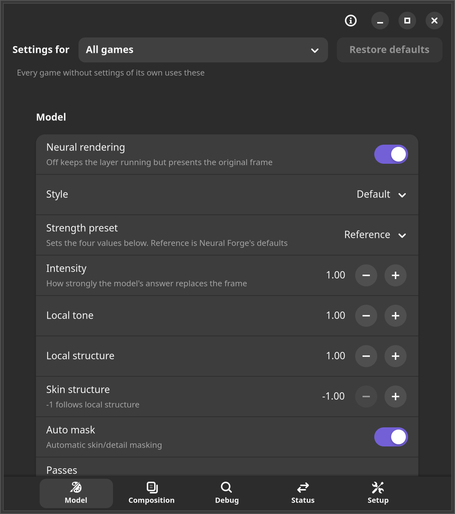
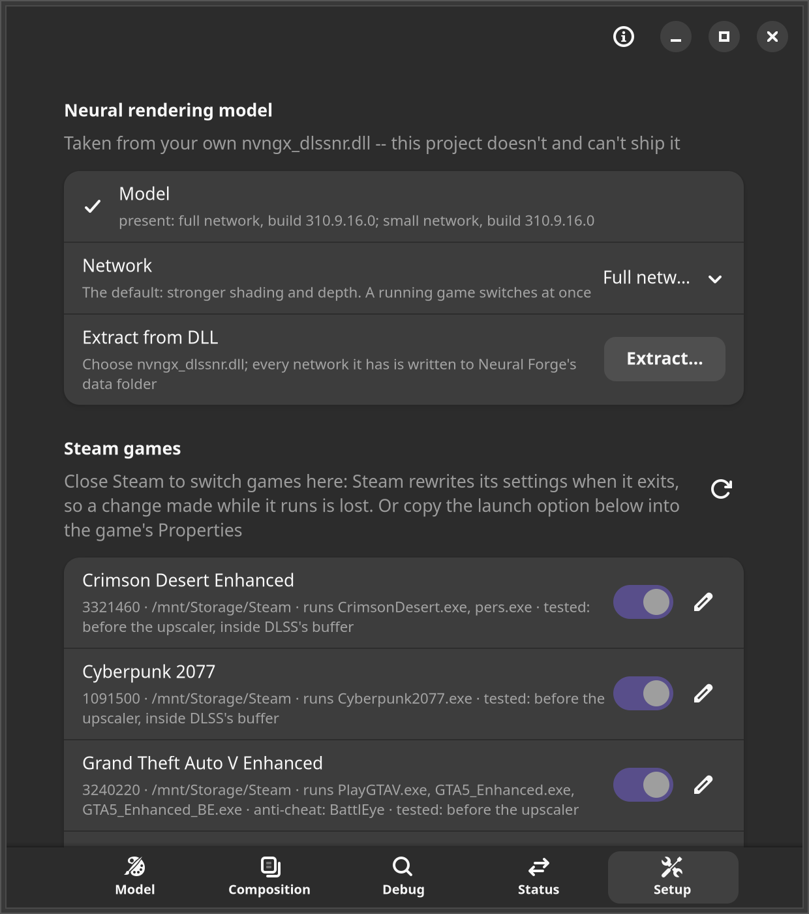
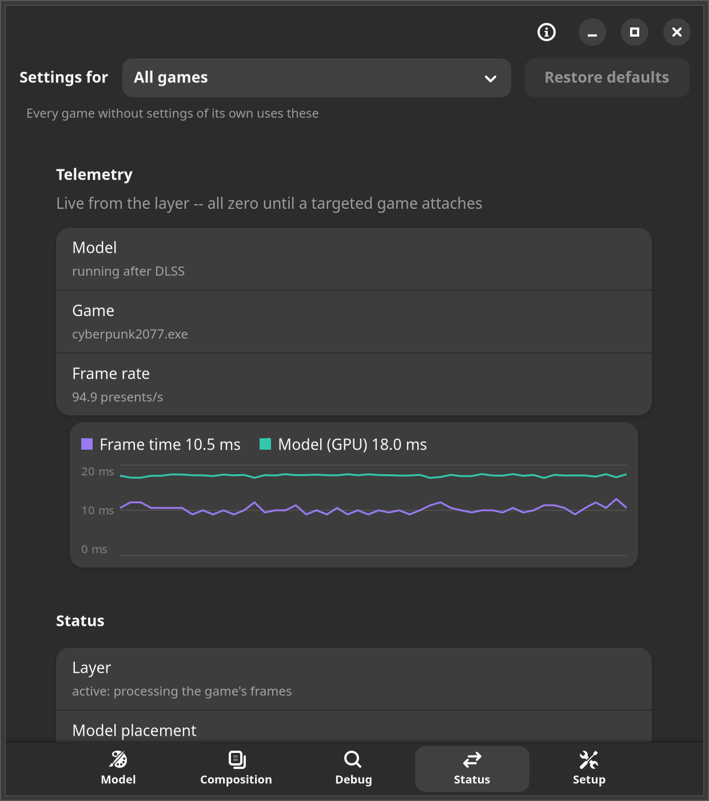

# Neural Forge

Neural Forge runs NVIDIA's DLSS 5 neural-rendering network in Linux games, on your own GPU. In games
that use DLSS the network works on the frame before DLSS upscales it; in other games it works on the
finished frame. A GTK4 app (and a CLI) sets it up and tunes it.

This is experimental, personal-use software that runs NVIDIA's proprietary model weights outside
NVIDIA's own runtime. Read [Legal](#legal) before you use it.

| Model settings | Setup | Status |
|---|---|---|
|  |  |  |

## Requirements

- x86_64 Linux with glibc 2.39 or newer (Ubuntu 24.04, Fedora 40 or later), GTK 4.12 and
  libadwaita 1.5 or newer.
- An NVIDIA RTX 40-series or newer GPU with a Vulkan driver that offers `VK_NV_cuda_kernel_launch`,
  `VK_KHR_cooperative_matrix`, `VK_NV_cooperative_matrix2` and `VK_EXT_shader_float8` (tested with
  615.71.09, 615.78.08 and 620.70.06). On other GPUs the layer does nothing.
- Steam with Proton 10 or newer (GE-Proton10+, Proton-CachyOS, Valve's Proton 10/11 or Proton Experimental:
  the Neural Forge Proton is made from it), and 64-bit games. Native Linux games run without Proton. Flatpak Steam cannot
  see the layer: use your distribution's package.
- Your own `nvngx_dlssnr.dll` (from a game that ships it, or NVIDIA's SDK), once. It is not shipped
  here.

## Install

1. Download the AppImage from [Releases](https://github.com/labj1987/neural-forge/releases), then
   `chmod +x neural-forge-*-x86_64.AppImage` and run it. Nothing needs root.
2. Setup tab: **Extract from DLL** and pick your `nvngx_dlssnr.dll`. The DLL is not needed after that.
3. Close Steam, then switch your games on in the Setup tab's Steam games list. Start Steam again.
4. Play. The model starts after 5 seconds of steady rendering. Settings apply live, and the app can be
   opened or closed at any time.

**F11** switches the model off and on. It reads the keyboard through evdev, which needs your user in
the `input` group (log out and in again afterwards): `sudo usermod -aG input "$USER"`.

## How it works

A Vulkan layer inside the game runs the network on the game's GPU. In a DLSS game it needs to know
exactly what the game hands DLSS, so Neural Forge makes a copy of your Proton
(`<version>-NeuralForge`, next to the original, no extra space on the same drive) with a small hook
in the NGX module that reports it. The layer then runs the network on DLSS's input and DLSS upscales
the result (with Ray Reconstruction it runs right after DLSS). Switching a game on sets its Proton to
the copy automatically, which needs Steam closed; switching it off puts the old one back. Your own
Proton is not changed.

A DLSS game that is not on the Neural Forge Proton gets no model, and the Status tab says why. Games
without DLSS get the model on the finished frame. Games with HDR work too, and the Status tab shows an
HDR verdict. How it works in detail: [docs/USER_GUIDE.md](docs/USER_GUIDE.md#how-it-works).

Online and anti-cheat games: the hook goes into the game's Proton, not the game, but anti-cheat may
still refuse it and ban the account. Use Neural Forge in single-player games. A game that ships
anti-cheat asks before it is switched on. Online modes with anti-cheat are not supported.

## Settings

The Model tab holds the switch, style and strength presets, passes, where the model runs and the colour
and sharpening groups. The Setup tab picks the full network (the default) or the small one, which takes
about half the GPU time and changes the picture less. Settings can be set per game (**Settings for**
under the tabs). Every setting, the tested games, environment variables and the CLI:
[docs/USER_GUIDE.md](docs/USER_GUIDE.md).

## Troubleshooting

Start with **Diagnose** on the Status tab (or `neural-forge-cli doctor`). It checks the install, the
GPU and driver, video memory, GPU faults, the last game's log, the NGX hook and each game's Proton, and
says what to do.

- **"off: this game uses DLSS but isn't on the Neural Forge Proton".** Close Steam, switch the game
  off and on again in the Setup tab (or **Make copy** under **Proton with DLSS parameters**), and
  restart Steam. If the line says the game *is* on a Neural Forge Proton but no record of DLSS reached
  the layer, run **Diagnose**: the copy's NGX wrapper is outdated or did not load.
- **The model runs on the finished frame in a DLSS game.** DLSS is not upscaling there: switched off,
  another upscaler, Frame Generation only, or DLAA. Loading screens and menus before DLSS's first frame
  stay untouched; the finished frame takes over after 5 minutes without DLSS, or 30 s of DLSS with no
  frame worked on.
- **"waiting for DLSS Super Resolution".** The game is not using DLSS Super Resolution (native
  resolution counts as not); the model runs on the finished frame.
- **"DLSS input identified, not holding".** The reason follows on the same line; the model runs on
  the finished frame. Attach the Save report zip to an issue.
- **"The network is paused: too little video memory".** The model resumes once there is room. A 12 GB
  card is at its limit at 4K: close programs that hold video memory (browsers with hardware
  acceleration).
- **HDR does not come on.** The Status tab's HDR line says why. Under Proton add
  `PROTON_ENABLE_WAYLAND=1 PROTON_ENABLE_HDR=1` to the launch options (Proton-GE), or start gamescope
  with `--hdr-enabled`; if HDR10 was available, switch on the game's own HDR setting.
- **Something looks wrong.** Press F11 to compare. `NEURAL_FORGE_PREUPSCALE=off` in the launch
  options keeps the network from loading at all.
- **A game refuses to start or go online.** `PROTON_NO_NEURAL_FORGE_NGX=1` in its launch options runs
  it without the hook.
- **F11 does nothing.** Add yourself to the `input` group (see [Install](#install)).
- **Steam Linux Runtime:** if the game cannot reach Neural Forge, add
  `PRESSURE_VESSEL_FILESYSTEMS_RW=/tmp/neural-forge-$UID` to the launch options.
- **NVIDIA `Xid 109` or `Xid 119` GPU hangs** are a known NVIDIA driver bug under Proton, also
  without Neural Forge ([NVIDIA/open-gpu-kernel-modules#1097](https://github.com/NVIDIA/open-gpu-kernel-modules/issues/1097)).

More: [docs/USER_GUIDE.md](docs/USER_GUIDE.md#more-known-issues).

## Known issues

- **GTA V Enhanced sometimes crashes during "Game Init".** A bug in the game; relaunch.
- **The game's DLSS Frame Generation does not always switch on**, with or without Neural Forge. In
  GTA V Enhanced, set `FrameLimit` 120 in its settings.xml and it stays on.
- **At 4K a 12 GB card is at its video memory limit**, most of all with Ray Reconstruction.
- **Unreal Engine 5 games are only partly tested.**
- **On the finished frame, Find the HUD can treat a first-person weapon as HUD.** Switch it off in
  the Model tab where that shows.

More: [docs/USER_GUIDE.md](docs/USER_GUIDE.md#more-known-issues).

## Uninstall

Use **Uninstall…** at the bottom of the Setup tab (Steam closed). It removes the layer, the model,
the settings, Neural Forge's Proton copies (each game gets its earlier Proton back), its entries in
your games' launch options and the AppImage. Deleting only the AppImage leaves the layer installed.
From a terminal: `~/.local/share/neural-forge/bin/neural-forge-cli uninstall --purge`.

## Performance

At 4K on an RTX 5070 the model costs frame rate; the small network costs about half as much as the
full one. Numbers per game: [docs/MEASURED_RESULTS.md](docs/MEASURED_RESULTS.md).

## Reporting a bug

Use the [issue form](https://github.com/labj1987/neural-forge/issues/new/choose) and attach the zip
that **Save report** (Status tab) writes to your desktop, ideally while the game is running. It holds
the layer's log, the live status, your settings, the game's entry in the tested games and the HDR
verdict. Personal names are removed, and of a game's launch options only Neural Forge's part is
included. Building from source: [docs/RUNNING_AND_MEASURING.md](docs/RUNNING_AND_MEASURING.md),
section 1. Everything else: [docs/README.md](docs/README.md).

## Legal

Neural Forge does not load or run NVIDIA's DLL, and it contains no workaround for NGX's caller
check. `extract-model` reads the model's weights out of the resource data of your own copy of
`nvngx_dlssnr.dll`: no code is read, nothing is decrypted, no check is bypassed. The weights are
NVIDIA's; they are not distributed here, and running them outside NVIDIA's runtime may be restricted
by NVIDIA's NGX licence, depending on jurisdiction and how you use it. There's no licence grant
here for NVIDIA's model and none implied. Use it at your own legal risk, for personal,
non-commercial use.

This project reads and adapts source from
[DLSS5VKLayer](https://github.com/bmitch87/DLSS5VKLayer) (AGPL-3.0); see
[ATTRIBUTION.md](ATTRIBUTION.md) for what is taken and from where. Upstream's license is AGPL-3.0,
which is why this project's license is AGPL-3.0-or-later as well: a requirement for the adapted
code, not just a preference.

## License

This project's own code is licensed under the **GNU Affero General Public License v3.0 or later
(AGPL-3.0-or-later)**; see [LICENSE](LICENSE). NVIDIA's model weights, which the user extracts from
NVIDIA's DLL, are not covered by it and are not redistributed here. The network's source in
`third_party/opendlss-nr` keeps its MIT licence (`third_party/opendlss-nr/UPSTREAM.md`); the Rust
crates and their licences are listed in [THIRD_PARTY_CRATES.md](THIRD_PARTY_CRATES.md).

## Acknowledgements

- [DLSS5VKLayer](https://github.com/bmitch87/DLSS5VKLayer) (bmitch87): the architecture, the
  composition strategy and many ported functions ([ATTRIBUTION.md](ATTRIBUTION.md)).
- [OpenDLSS-NR](https://github.com/maanHimself/OpenDLSS-NR) (maan): the network implementation the
  layer runs (in `third_party/opendlss-nr`).
- [vk-layer-for-rust](https://github.com/google/vk-layer-for-rust) (Google): the Vulkan layer
  framework (in `third_party/vk-layer-for-rust`).
- [OptiScaler](https://github.com/cdozdil/OptiScaler),
  [OptiScaler_DLSSNR](https://github.com/Dagherbou/OptiScaler_DLSSNR), RenoDX (clshortfuse), hhkbble
  and xenmods ([DLSSNR-Cost-Scaler](https://github.com/xenmods/DLSSNR-Cost-Scaler)): ideas and
  composition techniques.
- Development assistance: Claude Code (Anthropic) and Codex (OpenAI).
