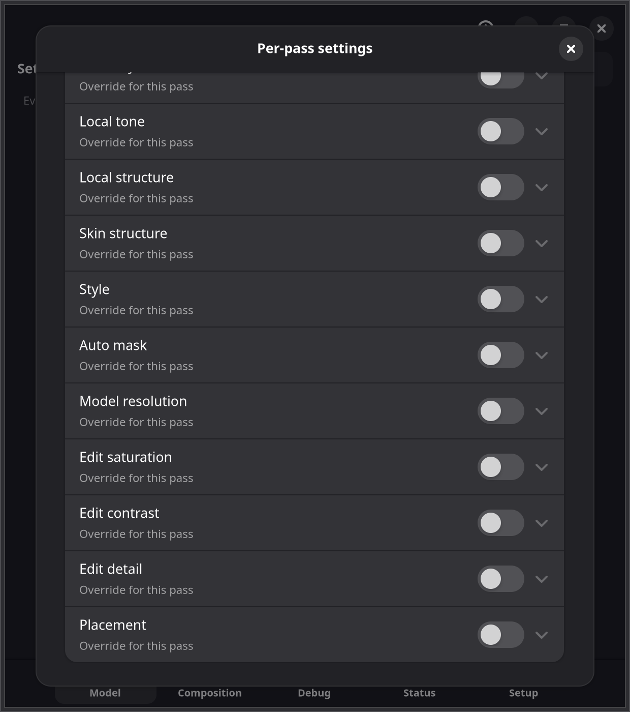

# Neural Forge user guide

The [README](../README.md) covers installing and using Neural Forge. This guide has the rest, for the
newest release: how the model runs, every setting, the games it was tested in, the environment
variables, the CLI and the files it writes. Measurements are in [MEASURED_RESULTS.md](MEASURED_RESULTS.md).

## How it works

The network runs inside the game's process, in the Vulkan layer, on the game's GPU. NVIDIA's DLL is
not loaded at run time: the layer reads the model's weights from the folder `extract-model` wrote
(see [Install](../README.md#install)). Two networks come in NVIDIA's DLL; both are extracted, and the Setup
tab's **Network** row chooses which one runs:

- **Full network** (71 blocks), in every build of the DLL, and the default. Its shading and depth are
  stronger.
- **Small network** (31 blocks, the same kinds of blocks with fewer of each), in build 310.9.16. It
  takes about half the GPU time of the full one and changes the picture less. It is what NVIDIA's own
  runtime runs from build 310.9.16 at its default preset.

A game that is running switches to the chosen network at once: its next frames go to DLSS untouched
while the network loads, and the network's history starts afresh. When the chosen network is not
extracted (a DLL without the small one), the other one runs.

When the game and other programs leave too little video memory for the network, the driver would move
part of it to system memory, where it runs many times slower. Instead the full network gives way to the
small one, and when that does not fit either, the network pauses and frames go to DLSS untouched. It
steps back up, one network at a time, once the memory has had room for it for 10 s (and no sooner than
30 s after the step down, longer when the steps repeat). While paused, Neural Forge holds no video memory. The Status tab's Model placement line says when
the small network runs in place of the full one, or that the network is paused.

Each network's answer for an input frame is bit-exact with NGX's own
([NATIVE_BACKEND.md](NATIVE_BACKEND.md), 0.6 and "The small network").

The model runs in one of three places. With the Model tab's **Placement** at **Auto** (the default) the
layer picks the place for each game by itself:

- **Before the upscaler**, when the game uses DLSS Super Resolution (at Quality, Balanced,
  Performance or DLAA). The layer recognises the frame the game hands to
  DLSS: the scene at render resolution, in HDR (16-bit float), without the HUD. It holds that DLSS
  submission, runs the network on the frame (every frame while the camera is still, every second
  frame in motion, with the edit cache carrying it between), with DLSS's motion vectors and camera
  jitter for its history, and writes the answer back before DLSS upscales it. DLSS then upscales the
  enhanced frame. The model works on fewer pixels and gets the input it was made for. Games that
  record their frame in DLSS's own command buffer (Crimson Desert) are held inside that buffer.
- **After DLSS**, when the game runs DLSS Ray Reconstruction: Ray Reconstruction's input is the noisy
  ray-traced frame before its denoising, which is not a frame the model can improve, so the model runs
  right after DLSS instead, on its denoised, upscaled frame at the output resolution, before the game's
  post-processing and HUD, with DLSS's motion vectors for its history. Where DLSS's output cannot be
  held there, the model runs on the finished frame. Switching Ray Reconstruction on or off in a game
  moves the model within a few frames.
- **On the finished frame**, for everything else: native resolution, games without DLSS, and
  devices without NVIDIA's `VK_NVX_image_view_handle`. The finished 8-bit
  frame is captured at present, answered by the network and composited back onto the same frame
  before it is shown. It has no history by default (no motion vectors there). The frame has the
  game's HUD in it: the layer finds the HUD and keeps the model's change off it (see
  [HUD on the finished frame](#settings)).

The game's own **DLSS Frame Generation** works with the model before the upscaler and after DLSS.
Generated frames are built from enhanced frames, and the model runs once per real frame.

To run the model on the finished frame instead, set Placement to Finished frame in the Model tab (live,
no relaunch). `NEURAL_FORGE_PREUPSCALE=off` in the launch options loads no network at all: the game's
frames are presented as it made them, the rollback when something looks wrong.

How it works, step by step: [ARCHITECTURE.md](ARCHITECTURE.md).

## Settings

### The app's tabs

| Tab | What it has |
|---|---|
| Model | The Neural rendering switch, the placement (where the model runs in the frame), the model's style, strength presets (Light, Moderate, Reference, Overdrive, Remix), intensity, local tone, local structure, skin structure, auto mask, passes, pass feedback, model resolution and per-pass settings, model brightness and its scale, keep the game's sky, more mask rules (dark areas, fast motion), model every Nth frame (after the upscaler only), the toggle key, the Colour group: saturation, contrast and detail of the model's change, gamut guard, dither, hue, grey, shadow and highlight protection and a look-up table, and the HUD group: finding the HUD and HUD regions on the finished frame. |
| Composition | How the model's answer is blended back on the after-the-upscaler path: detail and colour strength, highlight guard, model resolution after the upscaler (shown while the model runs there), the reversible proxy mode, transfer mode, colour trust, ratio smoothing, ghost guard, apply model edit, hold frame, and the white point; HDR input and Colour mode are shown but not used yet. |
| Debug | Compare views (side by side or wipe, split, zoom, swap), debug views (original/proxy, raw answer, amplified diff, colour trust, the composite before colour trust, and what the edit cache rejected before the upscaler), the edit cache at work (frames with and without the network, the share it rejected, its cost), the scene cuts the model started afresh on, and captures: take one (the next frame as before/after PNGs, with what happened) and open the captures folder. |
| Status | Telemetry (the model, the game, the frame rate, and a graph of the time per frame and the model's GPU time), layer state, **Model placement** (before the upscaler with DLSS's render size and missed frames, after DLSS with its output size, both, waiting for DLSS Super Resolution, or after the upscaler), the model, reset and profiles, and **Diagnosis**: Diagnose (the same checks as `neural-forge-cli doctor`) and Save report. |
| Setup | The model (present, or extract it from `nvngx_dlssnr.dll`), which network runs (Full network, the default, or Small network; a running game switches at once), your installed Steam games with a Neural Forge switch each, the executable it targets and an edit button to choose another (a game whose folder ships anti-cheat says which, and asks before it is switched on), and the launch option to copy by hand for a game you pick. |

Before the upscaler the network runs on every frame while the camera is still and on every second
frame while it moves; the frame in between reuses its last result, moved with the game's motion and
checked against depth and colour (the edit cache). Where the picture changes completely from one frame
to the next (a cut in a cutscene, a respawn, a camera switch), the model starts afresh instead of blending
in the previous scene. The model's answer is written straight back (there is no
composition step), so "Model every Nth frame" and the Composition tab only change the after-the-upscaler
path. The Model tab's tuning and the switch apply to both.

**Strength presets** set intensity, local tone, local structure and skin structure together:

| Preset | Intensity | Local tone | Local structure | Skin structure | What it matches |
|---|---|---|---|---|---|
| Light | 0.45 | 0.55 | 0.25 | 0.15 | A light touch. |
| Moderate | 0.70 | 0.80 | 0.55 | 0.40 | In between. |
| Reference | 1.00 | 1.00 | 1.00 | follows local structure | NVIDIA's own defaults for the network; Neural Forge's default. |
| Overdrive | 1.30 | 1.25 | 1.45 | 1.20 | Stronger than NVIDIA's defaults. |
| Remix | 1.00 | 0.30 | 0.70 | 0.50 | RTX Remix's defaults for its DLSS neural rendering. |

**Keep the game's sky** (on by default) leaves the sky untouched before the upscaler: no edit where the
game's depth is at the far plane, fading in over the distance just in front of it. **More mask rules** can
also fade the edit out in dark areas or in fast motion (both off by default). Together they are a per-pixel
mask of the model's intensity and structure, after NVIDIA's control mask (the semantics come from
GrimsVerk's runtime research).

**Passes** (1 to 10, default 1) runs the model that many times over each frame, before or after the
upscaler: every pass after the first works on the previous pass's picture. Each pass costs about as much
GPU time as the first, and the effect builds up with every pass. In GTA V Enhanced at 1440p with frame
generation 4x (real frames per second, pass 4 of the built-in benchmark, one run each; the small
network's one pass is from 2026-10-19, the rest from 2026-10-28):

| Network | 1 pass | 2 passes | 3 passes |
|---|---|---|---|
| Small | 74.3 | 60.4 | 52.8 |
| Full | 62.1 | 50.7 | |

Two passes of the small network cost about as much as one pass of the full network, and look
over-processed: grittier stone and noisier roads. Each pass keeps its own history, so the passes do not
blend toward each other's pictures over time. **Per-pass settings** (Edit…) let each pass use its own
intensity, local tone, local structure, skin structure, style, auto mask, model resolution, colour of the
change or placement instead of the Model tab's.
**Pass feedback** (0 to 1, default 1) sets how much of a pass's picture the next pass works on; lower
values keep more of the pass's own input, so the passes add less to each other.

**Model resolution** (Model tab) sets the size the model runs at, as a share of the frame it works on
(DLSS's input before the upscaler, DLSS's output after it): **Full** (the default), **Quality** (66.7%),
**Balanced** (58%), **Performance** (50%) or **Ultra Performance** (33.3%). Below Full the model works on a
downscaled copy of the frame and its change is brought back to full size, following the frame's own edges,
so the frame keeps its own detail; the model costs less GPU time and memory but adds less detail of its own.
Before the upscaler the frame is already small (1486x836 in GTA V at 1440p) and the smaller sizes keep
little of the model's detail; after DLSS, on the full output (with Ray Reconstruction), Performance keeps
most of it for about 30 fps more (see [MEASURED_RESULTS.md](MEASURED_RESULTS.md)). Full is the frame exactly as
without the setting. Each pass can have its own model resolution in the per-pass settings: a pass works
on the previous pass's full-size picture at its own size. Changing it starts the model's history afresh
and shows a moment of untouched frames while the model is prepared for the new size.

**Model brightness** (Model tab) sets how bright the picture the model works on is, before the upscaler and
after DLSS; the game's own brightness is kept either way, because the picture is brought back exactly
afterwards. **Game** (the default) uses the exposure the game gives DLSS (measured from the frame instead where a game's is always 0). **Auto** measures it from the frame, within half
to 16 times the game's own so night stays night, for games that give the model a very dark picture: in daytime
Crimson Desert's has a median brightness of 0.14 of white with Game and 0.50 with Auto. How the model treats the
shadows changes with it, so compare the two in the game. **Model
brightness scale** (0.25 to 4, default 1) brightens (above 1) or darkens (below 1) what the model sees on top
of either. `neural-forge-cli shmctl set preupscale_exposure game|auto` and `shmctl set preupscale_brightness
1.5` do the same from a terminal.

**Colour** (Model tab) shapes the model's change to the frame instead of the frame, before and after the
upscaler. **Saturation**, **contrast** and **detail of the change** (0 to 4, default 1) scale how much the
model changes colour, how much it brightens or darkens, and its fine detail against its broad change; at 0
the frame keeps its own colours, its own brightness, or only the broad change. They apply to every pass, and
the per-pass settings can give a pass its own. **Gamut guard** (on) shortens a change that would push a
colour past what the frame can hold instead of clipping one channel, so the hue stays. **Dither** (off)
breaks up banding in smooth gradients after the upscaler. Four **protections** (0, off, to 1) keep parts of the
frame's own look against the model's change, judged by eye-matched colour (Oklab): **Hue protection** keeps each
colour's hue (the model may still make it more or less colourful, brighter or darker), **Grey protection** keeps
greys free of a tint, **Shadow protection** holds back darkening of what was already dark and **Highlight
protection** holds back brightening of what was already bright. Shadow protection also takes away much of the
detail the model adds in darker textures, since that detail is darkening. **Look-up table** applies a 3D `.cube` file (17 to
65 points; the Choose button or `neural-forge-cli shmctl lut FILE`) to the last pass's result where the model
changed the picture: its strength (0, off) grows with the size of the change and is full at **Look-up table
full at**, so a pixel the model left alone keeps its colour. A table that is removed or cannot be read stops
applying, before and after the upscaler alike. At their defaults the picture is exactly the model's.

**Placement** (Model tab) sets where the model runs in the frame: **Auto** (the default; see
[How it works](#how-it-works)), **Before the upscaler** (with Ray Reconstruction on, the finished
frame), **After DLSS** (on DLSS's output, before the game's HUD and post-processing, at the output
resolution, so it costs more than before the upscaler; where a game's DLSS output cannot be held, it runs
where Auto would) or **Finished frame** (on the presented frame, HUD included; DLSS gets its input
untouched). Model resolution applies after DLSS too, as a share of the output size. Each pass can have its
own placement in the per-pass settings, so pass 1 can run before the upscaler and pass 2 after DLSS, each
with its own settings and history. Passes run in the frame's order: a pass placed earlier than the pass
before it runs where that one does, and passes on the finished frame after passes held in the game's frame
run after DLSS instead (the model serves one of the two at a time); the log says when a placement is moved.
`neural-forge-cli shmctl set placement auto|before|upscaled|present` (and `pass2_placement`, ...) does the
same from a terminal.

**HUD on the finished frame** (Model tab): where the model runs on the finished frame, the game's HUD is in
the picture. **Find the HUD** (on) keeps the model's change off what stays still and sharp while the
picture moves: text, icons, the minimap. It needs a few seconds of movement to find them, and a still
scene (a menu, a paused game) never adds to what it found. **HUD regions** are up to eight rectangles in
percent of the frame: **Keep** has no change inside, **Soften** keeps the change's strength (a share) inside;
the change comes back over a few pixels around each one. With a history after the upscaler, the history is
not used under the HUD either, so changing HUD text leaves no trail. They are saved as `set_hud_regions` in
`config.ini` and can be set with `neural-forge-cli shmctl set hud_regions "0,0.88,0.3,0.12;0.7,0,0.3,0.1,soften,0.5"`
(left, top, width, height in 0-1, then `keep` or `soften` and the strength). Before the upscaler and after
DLSS the HUD is not drawn yet, so neither setting applies there.

Settings are live: the GUI and the running layer share them through shared memory.
`neural-forge-cli shmctl status|set|toggle|capture` does the same from a terminal. The Debug tab's
Capture button (and `shmctl capture`) saves the next presented frame before and after Neural
Forge's composition and says what happened: where the files are and whether the effect changed the
frame, or why nothing was written; clicking again while it waits cancels it, and a request no game
takes is withdrawn after 5 seconds.

## Tested games

Each game was run on the test machine (RTX 5070, 2560x1440, Proton) with its own settings as found:
DLSS on, the game's frame generation on wherever it has it, no frame-rate cap. In each one the model
ran with no missed frames and no GPU fault.

| Game | Engine, API | DLSS used | Where the model runs |
|---|---|---|---|
| GTA V Enhanced | RAGE, DX12 | Super Resolution, Frame Generation 4x | Before the upscaler |
| Crimson Desert | BlackSpace, DX12 | Ray Reconstruction, dynamic Frame Generation | After DLSS with Ray Reconstruction on; before the upscaler, inside DLSS's buffer, with it off |
| GTA San Andreas - The Definitive Edition | Unreal Engine 4 | Super Resolution | Before the upscaler |
| Metro Last Light Redux | 4A Engine, DX12 | Super Resolution (the game's own DLSS 5 NR off) | Before the upscaler, inside DLSS's buffer |
| God of War (2018) | Santa Monica Studio, DX11 | Super Resolution | Before the upscaler |
| Marvel's Spider-Man Remastered | Insomniac, DX12 | Super Resolution, Frame Generation | Before the upscaler |
| Shadow Warrior 3: Definitive Edition | Unreal Engine 4, DX12 | Super Resolution | Before the upscaler |
| Lords of the Fallen (2023) | Unreal Engine 5, DX12 | Super Resolution, Frame Generation (launch option `-DLSSFG`) | Before the upscaler, inside DLSS's buffer |
| Remnant II | Unreal Engine 5, DX12 | Super Resolution, Frame Generation | Before the upscaler, inside DLSS's buffer |
| Hogwarts Legacy | Unreal Engine 4, DX12 | Super Resolution, Ray Reconstruction, Frame Generation | After DLSS with Ray Reconstruction on; before the upscaler, inside DLSS's buffer, with it off |

Setup notes for these games:

- **GTA San Andreas - The Definitive Edition** resets its Frame Rate setting to 60 at every launch,
  whatever its settings files say (a game bug). Set it to Unlocked in Options > Graphics each time.
- **Shadow Warrior 3** greys out its NVIDIA DLSS option while FidelityFX CAS is on (Settings >
  Video): set CAS to Off and DLSS becomes selectable. Its first launch also benchmarks the machine and
  picks the Low preset under Proton; set Overall Quality yourself.
- **Marvel's Spider-Man Remastered** starts with DLAA-like dynamic resolution (target 60 fps), V-Sync
  on and frame generation off: set Upscale Quality to a fixed mode, Frame Generation to DLSS Frame
  Generation and V-Sync off (Settings > Display and Graphics).
- **Crimson Desert** compiles shaders on its first launch after a Neural Forge update; the effect
  starts once it is in the world.
- **Lords of the Fallen (2023)** has no Frame Generation option in its menu: the developers turned
  DLSS Frame Generation off in patch 1.009 (October 2023), and the launch option `-DLSSFG` turns it
  back on (patch 1.1.193): add `-DLSSFG` after `%command%` in the launch options Neural Forge wrote
  (`NEURAL_FORGE_ENABLE=1 NEURAL_FORGE_TARGET_EXE=<exe> %command% -DLSSFG`). While the game's settings file
  says frame generation is on (`DLSSFrameGenerationEnabled=True` in
  `AppData/Local/LOTF2/Saved/Config/Windows/GameUserSettings.ini`), VSync and Reflex are on and
  greyed out; set it to `False` with the game closed to change them, at the cost of frame generation.

## Environment variables

Set in a game's launch options unless the table says otherwise. Every variable was checked against
the code (`crates/`, `scripts/`).

| Variable | Read by | Effect |
|---|---|---|
| `NEURAL_FORGE_ENABLE=1` | layer (manifest) | Turns the layer on for this game. |
| `NEURAL_FORGE_DISABLE=1` | layer (manifest) | Forces it off, overriding `ENABLE`. |
| `NEURAL_FORGE_TARGET_EXE=a.exe,b.exe` | layer | Only these executables (case-insensitive basenames) may use the layer, even one whose name is on the built-in list of launchers and helpers (a game whose executable is `Launcher.exe`). Switching a game on sets it to the game's own executables. Without it, the first process not on that list to present steadily takes the layer. |
| `NEURAL_FORGE_PREUPSCALE=off` | layer | Rollback: the network is not loaded, so no frame is changed (the layer log says so once). The model on the finished frame is the Placement setting's Finished frame instead. Unset (or `model`) is the default. An unknown value is logged and treated as `off`. |
| `NEURAL_FORGE_PREUPSCALE=dump\|identity\|roundtrip` | layer | Diagnostics: write DLSS's input to `captures/`, hold without the model (raw copy back), or run the HDR encode and decode with no model. They wait for their own work inside the game's submit, so a submit that waits on an event or on a timeline value not reached yet goes to DLSS untouched. See [RUNNING_AND_MEASURING.md](RUNNING_AND_MEASURING.md). |
| `NEURAL_FORGE_EDIT_CACHE=off` | layer | Before the upscaler, run the network on every frame instead of the edit cache's cadence (every frame while the camera is still, every second frame while it moves), with none of the cache at all (the game's depth is neither made copyable nor copied). For A/B comparisons, benchmarks and rollback; unset (or `on`) is the default. An unknown value is logged and the cache stays on. |
| `NEURAL_FORGE_SCENE_CUT=off\|N` | layer | Before the upscaler, how different two frames must be for the model to start afresh: the mean change of brightness, 1 to 255 (default 40), or `off` to never start afresh on a cut. For testing; an unknown value is logged and the default stays. |
| `NEURAL_FORGE_PREUPSCALE_PAPER_WHITE=3` | layer | The HDR encode's paper white (default 3; a positive number up to 1000). Tuning only. |
| `NEURAL_FORGE_PIPELINED=1` | layer | After the upscaler: a pipelined present. Higher frame rate, but answers land on later frames and ghost. |
| `NEURAL_FORGE_TOGGLE_KEY=F10` | layer | Toggle key by name (`F1`-`F12`, `Home`, `N`...) or Linux key code; overrides the GUI's. |
| `NEURAL_FORGE_HOTKEY_BACKEND=evdev\|x11` | layer | Forces one keyboard backend (default: evdev, then XInput2). |
| `NEURAL_FORGE_HOTKEY_GLOBAL=1` | layer | The toggle key acts even when another window has the focus. By default a press is ignored only while another window is known to have the focus; where that cannot be told (inside gamescope) the key acts. |
| `NEURAL_FORGE_MAX_MODEL_PIXELS=N` | layer | Largest raster the after-the-upscaler path gives the model (default 3840x2160 = 8294400). |
| `NEURAL_FORGE_LOG=/path` | layer | Log file (default: stderr), written by its own thread and rotated to `/path.1` at 64 MiB. |
| `NEURAL_FORGE_LOG_TIME=1` | layer | Testing aid: timestamp every log line. |
| `NEURAL_FORGE_SHM`, `NEURAL_FORGE_UID` | all | The shared-memory file, and the uid its directory is named after. Normally left alone. |
| `NEURAL_FORGE_PROBE_NGX=1` | layer | Testing aid: log the game's DLSS work as it reaches Vulkan ([PRE_UPSCALER_PROBE.md](PRE_UPSCALER_PROBE.md)). |
| `NEURAL_FORGE_PROBE_PARAMS=1`, `NEURAL_FORGE_PROBE_KERNEL=<name>` | layer | Testing aids: log every word of DLSS's input-kernel parameters, or of a named kernel's. |
| `NEURAL_FORGE_LOG_LAUNCH_QUEUES=1` | layer | Testing aid: log which queue each DLSS launch is submitted on. |
| `NEURAL_FORGE_CAPTURE_AT=N:MS[:FRAMES][,...]` | layer | Testing aid: capture the presented frame (or FRAMES consecutive frames) MS milliseconds after DLSS's frames resumed (after a gap) for the Nth time; 1 is the first frames. Several entries, separated by commas, are each taken once. |
| `NEURAL_FORGE_CACHE_DUMP_AT=N:MS[:K][,...]` | layer | Testing aid: dump K (default 16) consecutive holds before the upscaler for `scripts/cache_replay.py`, at the same moments `NEURAL_FORGE_CAPTURE_AT` names. `neural-forge-cli shmctl dump-cache [--holds K]` asks for one now. |
| `NEURAL_FORGE_WARMUP_SECS=N` | layer | Testing aid: seconds of steady rendering before the layer engages (default 5). |
| `NEURAL_FORGE_INLINE=off` | layer | Testing aid: never hold inside DLSS's command buffer. |
| `NEURAL_FORGE_NATIVE_CHAIN=0`, `NEURAL_FORGE_NATIVE_INLINE_CHAIN=1` | layer | Testing aids: barriers between the network's launches instead of counter chaining (before the upscaler), or counter chaining inside DLSS's buffer (where barriers are the default). |
| `NEURAL_FORGE_NATIVE_SKIP_GRAPH=1` | layer | Testing aid: record everything but the network's launches. |
| `NEURAL_FORGE_NATIVE_NO_HISTORY=1` | layer | Testing aid: every network frame without history, as after a reset. |
| `NEURAL_FORGE_PREUPSCALE_TRANSFER=aces\|linear` | layer | Testing aids: `aces` encodes the picture before the upscaler with RTX Remix's transfer (an ACES curve, and on the way back the model's change scaled by each pixel's own ratio, with Remix's highlight recovery); `linear` leaves out the sRGB curve (the network sees linear values, and the edit cache decodes the same way). `srgb` is the default. |
| `NEURAL_FORGE_PREUPSCALE_HIGHLIGHTS=off` | layer | Testing aid: before the upscaler, apply the model's change to the brightest highlights too: no keeping of clipped values, no fade near the top, no highlight recovery with `aces`. |
| `NEURAL_FORGE_PREUPSCALE_PICK=N` | layer | Testing aid: take the Nth colour candidate where DLSS's input launch names several. |
| `NEURAL_FORGE_PREUPSCALE_DUMP_FRAMES=N`, `NEURAL_FORGE_PREUPSCALE_DUMP_HAZARD=ignore` | layer | Testing aids for `NEURAL_FORGE_PREUPSCALE=dump`: consecutive frames per dump (default 1); dump even where DLSS's buffer synchronises depth or motion vectors. |
| `NEURAL_FORGE_PROBE_DEPTH=1`, `NEURAL_FORGE_PROBE_RR=<a,b,...>\|1` | layer | Testing aids: log the depth choice and barriers of the first 120 holds; log the images of the launches whose kernel names match (first 4000). |
| `NEURAL_FORGE_PROBE_IMAGE=<kernel>[+],...` | layer | Testing aid: copy the images a named CUDA launch reads, before it (or after it with `+`), once, into `captures/probe-<ms>/`. |
| `NEURAL_FORGE_NATIVE_SHARED_ACTIVATIONS=0` | layer | Gives every network activation its own allocation again instead of sharing memory by lifetime (more video memory, same result). |
| `NEURAL_FORGE_POST_MOTION=none\|zero\|flow`, `NEURAL_FORGE_POST_HISTORY_REJECT=0.12` | layer | Testing aids: after the upscaler, give the model a history: its previous output at the same pixel (`zero`) or where the GPU's optical flow says the pixel was (`flow`, on GPUs with `VK_NV_optical_flow`; `zero` elsewhere), not used where a pixel changed by more than the threshold (0 to 1, default 0.12) since the previous frame, and dropped on a scene cut. Default `none`: no history (measured, neither is steadier than none). |
| `NEURAL_FORGE_FAIL_CREATE=N[@K]`, `NEURAL_FORGE_NATIVE_FAIL=chain`, `NEURAL_FORGE_NATIVE_FAIL=vram` | layer | Testing aids: let K network builds through, then fail the next N; report one counter-chain timeout; or have the video memory guard step down at the 600th and 900th network frame, as if the network did not fit. |
| `NEURAL_FORGE_GUI_OPEN=<tab>` | GUI | Testing aid: open a tab (`model`, `composition`, `debug`, `status`, `setup`, or `passes` for the per-pass dialog) at start, for screenshots. |
| `NEURAL_FORGE_BENCH=1`, `NEURAL_FORGE_REQUIRE_VULKAN=1`, `NEURAL_FORGE_TEST_DISPLAY=:N` | layer tests | Testing aids: run the hot-path GPU benchmark; fail instead of skipping when no Vulkan device exists; run the present-fence test on a real swapchain in an X server (an Xvfb's display). |
| `NEURAL_FORGE_CLI=/path` | `scripts/install.py`, `scripts/test_install.py` | The `neural-forge-cli` to use. |
| `NEURAL_FORGE_NATIVE_TOOLS=<dir>`, `NEURAL_FORGE_PYTHON=<python>` | build | The native build tools' folder (default `tools/native`), and the Python 3.10+ the build runs. |
| `NEURAL_FORGE_NATIVE_RIG`, `NEURAL_FORGE_NATIVE_MODEL`, `NEURAL_FORGE_NATIVE_HEADS`, `NEURAL_FORGE_NATIVE_PROFILE=1` | native tests | Testing aids: run the network tests on a dumped frame, with a model folder, saving or comparing output heads, and timing each kernel. |
| `NEURAL_FORGE_NR_NO_FUSE_PRE`, `_NO_FUSE_POOL`, `_NO_FUSE_UPRES`, `_NO_FUSE_POST`, `_NO_PTX_MLP`, `NEURAL_FORGE_NR_CHAIN_MASK=N`, `_DEFER_MAX=N`, `_VIT_CHAIN=0` | network | Testing aids: turn off one of the network's fused kernels, or change how its launches are chained (`third_party/opendlss-nr/src/nr_graph.cpp`). `NEURAL_FORGE_NR_VALIDATION=1` and `NEURAL_FORGE_NR_DEBUG=1` apply only to the network's own standalone Vulkan context (its tools), not inside a game. |
| `NEURAL_FORGE_SMOKE_SO=/path` | `scripts/smoke-test.sh` | Test this layer library instead of building the debug one. |

## CLI

The CLI is installed as `~/.local/share/neural-forge/bin/neural-forge-cli`; add that folder to your
`PATH`, or call it by that path, for the commands in this guide.

`neural-forge-cli <command>`: `init`, `status`, `doctor`, `report [--appid ID]`, `games`,
`enable GAME [--target-exe EXE[,EXE...]|auto] [--anti-cheat-ok]`, `disable GAME`, `config`, `import-binaries DIR`,
`extract-model DIR [--network full|small]`, `install --appdir DIR`, `uninstall [--purge]`, `profile list|save|load|delete NAME`, and
`shmctl status|set NAME VALUE|toggle NAME|capture [--frames N] [--view V]|capture --cancel|dump-cache [--holds K]|reset|lut FILE|none`
for the live settings. `doctor`, `report` and `shmctl status` only look: they create and change nothing.
`neural-forge-cli help [COMMAND]` (or `COMMAND --help`) has the details; an unknown or misspelt
argument prints the usage and exits with status 2.

`enable` switches on a game whose folder ships anti-cheat only with `--anti-cheat-ok`; `games` names
the anti-cheat each game ships, and `doctor` warns about a game that is on with it. What is seen: Easy
Anti-Cheat, BattlEye, EA Javelin, RICOCHET, XIGNCODE3, NetEase, HoYoverse, Denuvo Anti-Cheat, FACEIT,
EQU8, nProtect GameGuard, Anti-Cheat Expert (ACE) and Nexon Game Security, by the files and folders
they leave in the game's folder. Anti-cheat installed outside it (Riot Vanguard, FACEIT's client,
Valve's VAC) cannot be seen.

## Files

| Path | What |
|---|---|
| `~/.config/neural-forge/config.ini` | Paths (`binaries=`, `shm=`, `edit_lut=` for the look-up table) and every setting as `set_<name>=`. The layer applies the saved settings when it opens the channel. |
| `~/.config/neural-forge/profiles.ini` | Named profiles. |
| `~/.local/share/neural-forge/` | The installed layer and GUI, the extracted model (`model/`), an imported DLL (`binaries/`), captures (`captures/`). |
| `~/.local/state/neural-forge/layer.log` | The layer's session log: state changes and errors only, never per frame (kept to 256 KiB, the previous one as `layer.log.1`). Diagnose and the report read it. |
| `/tmp/neural-forge-$UID/shm.bin` | The shared memory the layer and the GUI talk through. |

## Uninstall

`neural-forge-cli uninstall` removes the files it installed (files you changed are kept).
`neural-forge-cli uninstall --purge` also removes the config, everything under
`~/.local/share/neural-forge` (the model, an imported DLL, captures), `~/.local/state/neural-forge` and
`/tmp/neural-forge-$UID`.

## More known issues

- **Each DLSS game needs a test run before it is claimed:** engines hand DLSS its inputs in
  different ways, and several broke an assumption the first time. See [Tested games](#tested-games).
- **The model after DLSS is tested in two games** (Crimson Desert and Hogwarts Legacy, with Ray
  Reconstruction). Where a game's DLSS output cannot be held, the model runs on the finished frame, at a
  much lower frame rate (36 against 120 fps shown in Crimson Desert).
- **Not carried over from upstream DLSS5VKLayer:** see
  [UPSTREAM_PARITY.md](UPSTREAM_PARITY.md).

## More troubleshooting

- **The model does not run.** The Status tab's Model placement line, or Diagnose, gives the reason:
  no model extracted, a missing device feature, or a failed build (retried on its own). The full
  layer log (`NEURAL_FORGE_LOG=/path` in the launch options) has the `[native]` lines.
- **Steam overlay problems.** The layer leaves the overlay's own small swapchain alone, and only the
  executables in `NEURAL_FORGE_TARGET_EXE` (which switching a game on sets) can use Neural Forge.
- **32-bit games** are not supported (see [Requirements](../README.md#requirements)).
